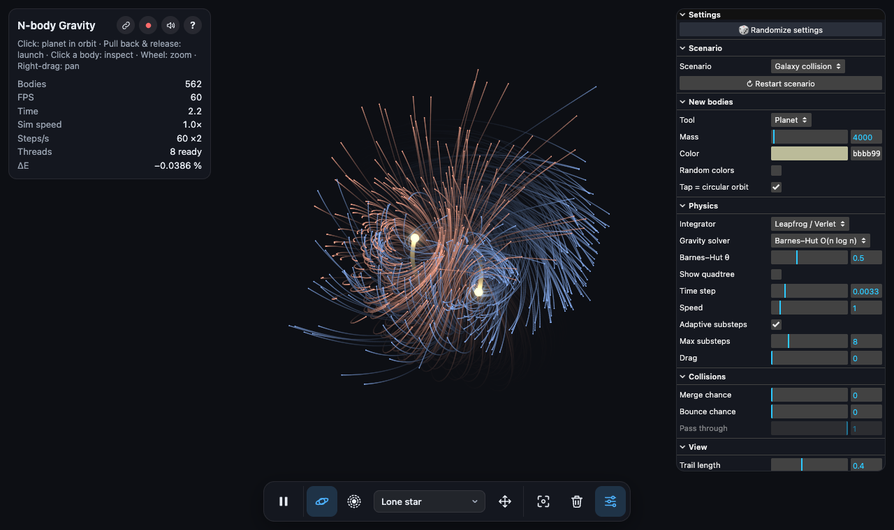

# N-body Gravity Simulation



**[Try it live](https://lemmingapex.github.io/N-bodyGravitySimulation/)**. It works in any modern browser on desktop, tablet or phone.

An interactive [N-body simulation](https://en.wikipedia.org/wiki/N-body_simulation) of [Newton's law of universal gravitation](https://en.wikipedia.org/wiki/Newton%27s_law_of_universal_gravitation), written in plain JavaScript with no build step.

## Features

- **Launch planets like a slingshot**: press, pull back and release, with a live trajectory preview. Tap or click without dragging to drop a planet straight into a circular orbit.
- **Drop in whole scenarios**: pick one in the toolbar, then click to add a copy of any scenario (a solar system, a binary star, a galaxy...) wherever you like, and pull back to send it flying. A faint ghost shows exactly what will be added.
- **Twelve scenarios**: a lone Sun-like star to build your own system around, protoplanetary disk, solar system (with asteroid belt, comet and moons), the Sun, Earth and Moon, binary star, the figure-eight three-body choreography, a galaxy collision, a cold cloud collapse, Trojan asteroids at the Lagrange points, gravity-assist flybys, a moon torn into a ring inside the Roche limit, and a 10,000-star spiral galaxy.
- **Four integrators**: [Euler](https://en.wikipedia.org/wiki/Semi-implicit_Euler_method), [Leapfrog/Verlet](https://en.wikipedia.org/wiki/Leapfrog_integration), [Yoshida 4th-order symplectic](https://en.wikipedia.org/wiki/Leapfrog_integration#4th_order_Yoshida_integrator) and [Runge–Kutta 4](https://en.wikipedia.org/wiki/Runge%E2%80%93Kutta_methods). Leapfrog is the default: about a third of the cost of RK4, and over long runs it keeps energy steadier.
- **Gravity solvers**: _Auto_ (the default) sums gravity exactly until there are 2,000 bodies, then switches to Barnes–Hut. Or choose exact O(_n²_) or [Barnes–Hut](https://en.wikipedia.org/wiki/Barnes%E2%80%93Hut_simulation) O(_n_ log _n_) with an adjustable opening angle θ. Turn on _Show quadtree_ to watch the tree it builds: cells subdivide wherever bodies crowd together, and each cell far enough away is treated as a single mass.
- **Collisions by chance**: set the chance that touching bodies merge (conserving mass and momentum) and the chance they bounce (with adjustable restitution); the rest pass through each other. Each encounter is rolled when two bodies first touch and holds until they separate, so the same pair can pass through once and merge the next time they meet.
- **Adaptive substeps** shrink the time step automatically during close encounters, so fast flybys stay accurate without slowing everything else down.
- **Live stats**: bodies, frame rate, simulated time, the speed the simulation is actually running at (amber when the physics can't keep up), physics steps per second, CPU threads in use, and the energy drift (ΔE) that shows how well the integrator conserves energy.
- **Inspect any body**: tap or click it to see its mass, speed and orbit (who it orbits, eccentricity, period), then follow it with the camera or delete it.
- **Camera**: pan, zoom and pinch, follow the center of mass, the heaviest body or the selected body, and fit view. Trails stay attached to the world while the camera moves.
- **Share links** encode the exact bodies, settings and view in the URL. Huge scenes fall back to scenario + random seed.
- **Record** the simulation and download it as a video (WebM/MP4) or an animated GIF, with an instant replay.
- **Sound**: ambient space music and sound effects, all synthesized live in the browser (no audio files). Launches whoosh, scenarios arrive with a deep swell, and collisions thump or tick, louder for bigger and faster impacts and panned to where they happen on screen; collisions also flash. Mute with the speaker button or <kbd>A</kbd>; music and effect volumes are in settings.
- **Fast**: physics runs in a Web Worker so the interface never stutters, big systems split gravity, collision detection and the Barnes–Hut tree across every spare CPU core, and everything is drawn with WebGL 2: crisp bodies, thin continuous comet-like trails and glowing stars. With 8 threads, 50,000 bodies run in real time, even when they all bounce off each other.
- **Mobile-first controls**: touch gestures, a bottom toolbar with large touch targets, a bottom-sheet settings panel, safe-area support, and sharp rendering on high-DPI screens.
- **Settings** explain themselves when you hover over them, persist between visits, and include the background color. **Randomize settings** (<kbd>D</kbd>) rolls new collision chances, speed, trails, colors and more; **Reset settings** undoes it. **Save image** exports a PNG.

## Controls

| Action               | Mouse / trackpad                      | Touch                            |
| -------------------- | ------------------------------------- | -------------------------------- |
| Add planet           | Click                                 | Tap                              |
| Launch with velocity | Pull back and release                 | Pull back and release            |
| Add a scenario       | Pick it in the toolbar, then click    | Scenario tool, pick it, then tap |
| Inspect a body       | Click it                              | Tap it                           |
| Zoom                 | Wheel or pinch                        | Pinch                            |
| Pan                  | Right-drag, middle-drag or Shift-drag | Two-finger drag, or the pan tool |

Keyboard: <kbd>Space</kbd> pause · <kbd>.</kbd> step · <kbd>P</kbd>/<kbd>S</kbd>/<kbd>M</kbd> tools · <kbd>1</kbd>–<kbd>9</kbd>, <kbd>0</kbd> scenarios · <kbd>R</kbd> fit view · <kbd>F</kbd> follow · <kbd>+</kbd>/<kbd>-</kbd> zoom · <kbd>[</kbd>/<kbd>]</kbd> speed · <kbd>C</kbd> clear · <kbd>V</kbd> record · <kbd>A</kbd> sound on/off · <kbd>D</kbd> randomize settings · <kbd>L</kbd> share link · <kbd>Delete</kbd> delete selected · <kbd>G</kbd> settings · <kbd>?</kbd> help.

## Physics notes

- **Units.** G = 1 and one length unit is one CSS pixel at zoom 1. A body's radius grows logarithmically with its mass.
- **Softening.** Bodies are treated as uniform spheres. When two bodies overlap, the force falls off linearly to zero instead of diverging, so close passes stay finite. The potential energy uses the same model, which keeps energy diagnostics consistent with the forces.
- **Integration** advances the whole system at once in every stage. The original version froze all other bodies while stepping each one, which isn't true RK4. The test suite checks that each integrator converges at its theoretical order.
- **Slow, steady time.** At 1× speed 0.2 time units pass per real second (a typical orbit takes 15–20 s), independent of the display's frame rate. The time step (default 1/300) only trades accuracy for CPU; at slow speeds it shrinks further so there is still a step every frame. When the device can't keep up, the simulation slows down gracefully instead of stuttering.
- **Adaptive substeps.** Each step is split into substeps (up to 8 by default, adjustable to 32) when some body accelerates hard enough to cross its own radius in less than a step: Δt ≤ η·√(r/|a|) with η = 0.5. The HUD shows ×N when this happens. In the galaxy collision it cuts the energy error over a minute from about 1 % to under 0.1 %, for about 2.5× the work per step; turn it off for speed.
- **Energy drift (ΔE)** is the change in total energy since bodies or physics settings last changed, relative to the system's kinetic + potential energy. It shows – while bodies keep merging, because merging legitimately changes the energy.
- **Trajectory preview.** While aiming, a small simulation runs ahead: the new body and the 32 heaviest bodies move under their mutual gravity (so moving stars, binaries and passing planets are followed) while lighter bodies are held fixed. It uses the same integrator as the simulation and fades out along its length, because close passes by small bodies eventually make any prediction guesswork.
- **Trails**: the trail length runs from 0 (no trails) to 1 (permanent trails that never fade); 0.4, the default, shows about 3 seconds of motion at 1× speed. Trails are tied to simulated time, so they freeze when paused and keep their shape at any speed.
- **Drag** is applied as exact exponential velocity decay, split around the gravity step so it works with every integrator.
- **Barnes–Hut** leaves hold up to 8 bodies, and the tree is walked once per leaf rather than once per body: the walk collects what acts on the whole leaf, measuring distances to the nearest of its bodies, so it is never less accurate than a per-body walk. Bodies are reordered so each cell's bodies sit together in memory.
- **Threads.** With 3,000 or more bodies, building the tree, evaluating forces and searching for collisions are split across helper threads that share memory; each claims chunks of work until none are left. The top of the tree is split serially into subtrees that threads build and that are then spliced into place, and collision pairs are gathered chunk by chunk in order, so the tree, the forces and the collisions are bit-for-bit identical to one thread (unit tests with real Node threads and a browser test check this). The stats show how many threads there are. Shared memory needs a [cross-origin isolated](https://developer.mozilla.org/docs/Web/API/Window/crossOriginIsolated) page: `npm start` sends the headers, and on hosts that can't (GitHub Pages) a small service worker (`coi-sw.js`) adds them, which reloads the page once on the first visit. Without isolation everything still works on one thread.
- **Collision detection** uses a hashed grid two typical radii wide, so each body only checks its own and neighbouring cells; the few largest bodies check every cell they reach.

## Development

Requires Node.js 22 or newer for tooling only. The app itself is static files.

```sh
npm install        # dev tools only (ESLint, Prettier, TypeScript, Playwright)
npm start          # serves the app at http://127.0.0.1:8080
npm test           # unit tests (node:test)
npm run test:e2e   # browser smoke tests (desktop + emulated phone)
npm run check      # lint + format check + type check + unit tests
```

ES modules can't be loaded from `file://` URLs, so use `npm start` (or any static server) instead of opening `index.html` directly. In the browser console, `nbody` holds the running app for experiments, e.g. `nbody.client.bodies.length` or `nbody.setSettings({ integrator: "leapfrog" })`.

End-to-end tests use Playwright's Chromium if it's installed (`npx playwright-core install chromium`), otherwise your local Google Chrome.

### Project layout

```
index.html              Page shell, toolbar and help dialog
coi-sw.js               Service worker adding cross-origin isolation headers (for threads)
src/main.js             App: frame loop, wiring of physics, rendering and input
src/settings.js         Settings schema, validation and persistence
src/share.js            Share-link encoding (compressed, validated)
src/stamp.js            Copies of scenarios for the scenario tool
src/isolation.js        Cross-origin isolation via coi-sw.js where the server can't send headers
src/engine/             Runs the physics: in a Web Worker, or on the main thread as a fallback
  engine.js             Command handler around Simulation (no DOM, unit-tested)
  worker.js             Worker entry point
  threadPool.js         Splits physics work across threads that share memory
  poolWorker.js         Helper thread of the pool
  jobs.js               The work threads can do: forces, collision search, tree building
  client.js             Main-thread client: body mirror, commands, back-pressure
src/styles.css
src/physics/            Pure simulation code (no DOM), fully unit-tested
  simulation.js         Simulation class: bodies, stepping, diagnostics
  gravity.js            Softened direct-sum gravity and potential energy
  barnesHut.js          Quadtree Barnes–Hut solver (bucketed leaves, group traversal)
  integrators.js        Euler, leapfrog, Yoshida 4, RK4
  collisions.js         Grid-based detection, merging, bouncing
  orbits.js             Circular-orbit velocity, trajectory prediction, orbital elements
  presets.js            Scenarios and the star-system generator
src/ui/                 Browser-only code
  glRenderer.js         WebGL 2 renderer: instanced bodies, streaked half-float trails, glows
  overlay.js            2D overlay: aiming, trajectory preview, selection rings, collision flashes
  sound.js              Procedural music and sound effects (Web Audio)
  gif.js, recorder.js   Animated-GIF encoder and video/GIF recording
  camera.js, input.js, controls.js, hud.js, inspector.js
test/                   Unit tests; test/e2e/ holds browser tests, test/support/ runs
                        worker scripts in Node threads for threaded tests
vendor/lil-gui/         Vendored control-panel library (npm run vendor)
```

TypeScript type-checks the JavaScript via JSDoc annotations (`npm run typecheck`); no compile step ships.

### Updating vendored dependencies

The settings panel uses [lil-gui](https://lil-gui.georgealways.com/), the successor to dat.gui. It's copied into `vendor/` so the site needs no bundler. To update, bump the version in `package.json`, then run `npm install && npm run vendor`. CI fails if `vendor/` doesn't match the lockfile.

### Deployment

GitHub Pages serves the repository root of `master` as-is. There's nothing to build. GitHub Pages can't send the cross-origin isolation headers, so `coi-sw.js` adds them (see _Threads_ above); keep it at the site root so its scope covers the whole app.

## License

[MIT](LICENSE)
